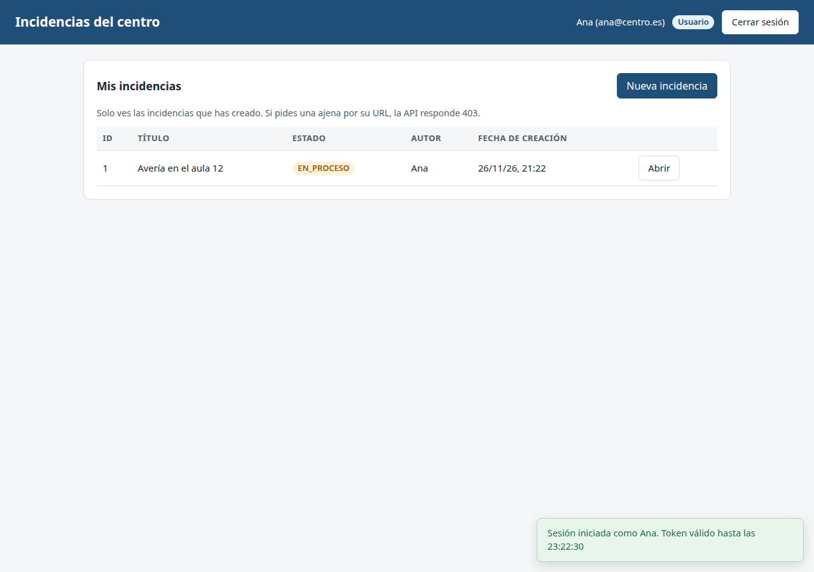
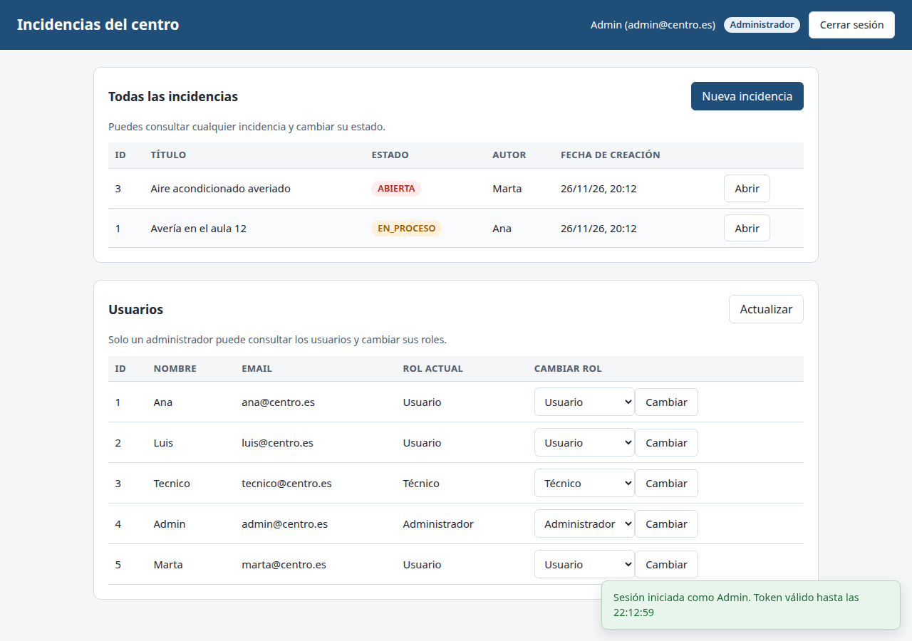
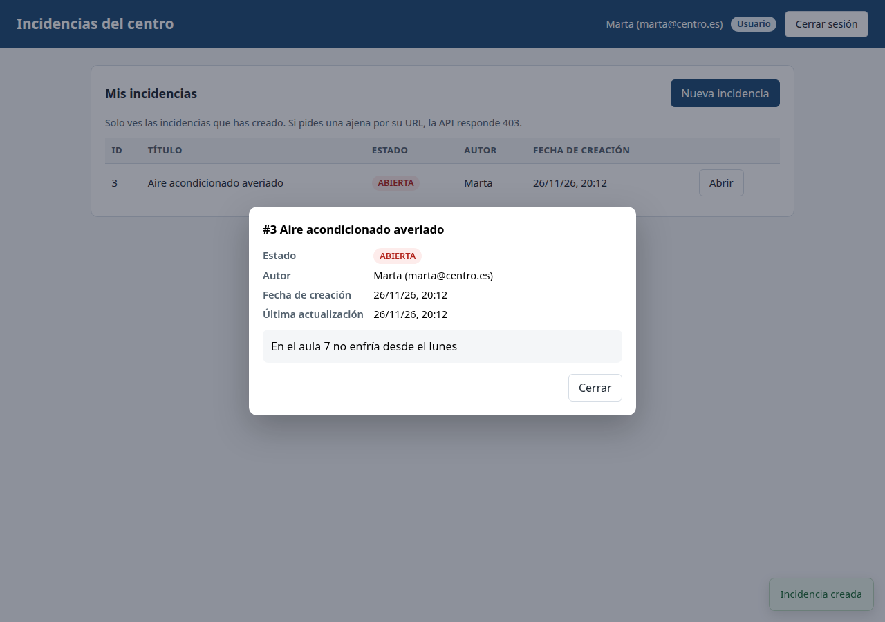
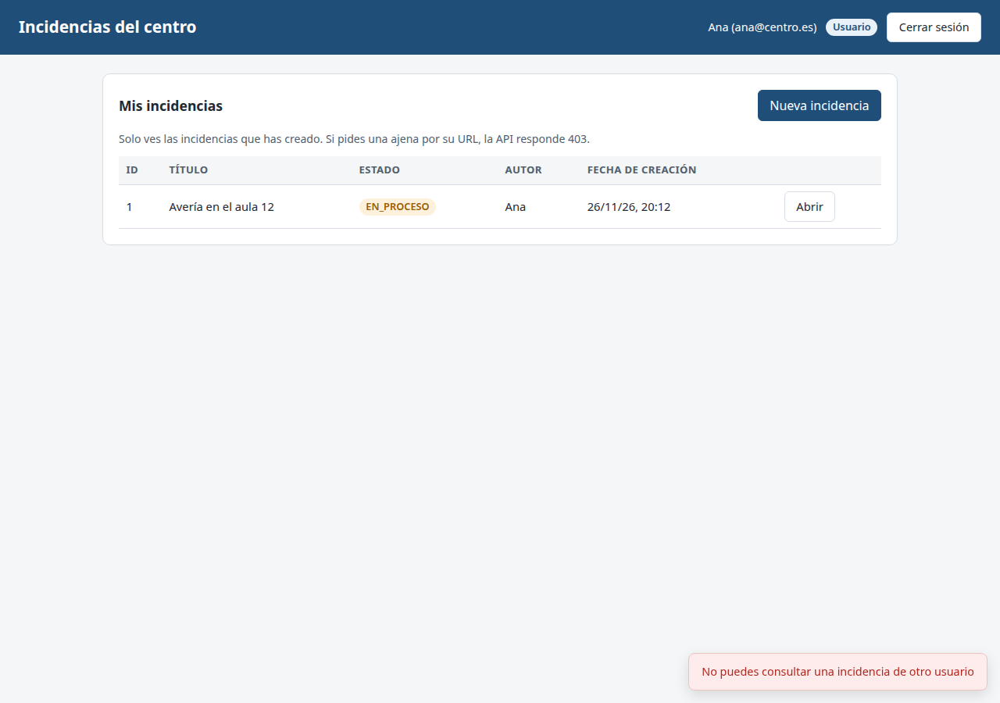

# IncidenciasAPI — incidencias del centro con JWT

API REST para registrar y gestionar las incidencias de un centro educativo
(averías en aulas, problemas con equipos informáticos…) con autenticación
mediante JWT y autorización por roles, más un frontend básico en HTML y
JavaScript.

Trabajo de la tarea *«API de incidencias del centro con JWT»* del módulo de
Programación de Servicios y Procesos, tomando como referencia el proyecto
[`26_27_MatriculasSpring`](https://github.com/samuprofe/26_27_MatriculasSpring).

---

## 1. Resumen de la aplicación

Cada incidencia tiene **título**, **descripción**, **fecha de creación**,
**estado** (`ABIERTA`, `EN_PROCESO`, `RESUELTA`) y **autor**. El autor nunca se
recibe del cliente: se obtiene del usuario autenticado en el JWT.

Roles y permisos implementados (comprobados en el backend):

| Acción | `ROLE_USER` | `ROLE_TECNICO` | `ROLE_ADMIN` |
|---|:---:|:---:|:---:|
| Crear una incidencia | Sí | Sí | Sí |
| Consultar sus propias incidencias | Sí | Sí | Sí |
| Consultar cualquier incidencia | No (403) | Sí | Sí |
| Cambiar el estado de una incidencia | No (403) | Sí | Sí |
| Eliminar cualquier incidencia | No (403) | No (403) | Sí |
| Consultar usuarios y modificar sus roles | No (403) | No (403) | Sí |

Además:

- Registro público que **siempre** crea `ROLE_USER` y guarda la contraseña con
  **BCrypt**.
- Login que devuelve un **JWT firmado con una clave configurada por
  propiedades**, con identificador de usuario, roles, caducidad y un *claim*
  adicional no sensible (`nombre`).
- Rutas generales protegidas en `SecurityConfig` y permisos por rol en las
  operaciones que lo necesitan.
- Filtrado de incidencias por autor en el listado **y** comprobación de
  propiedad al consultar una incidencia concreta (no basta con ocultar enlaces).
- Lista blanca de roles al modificarlos y todas las operaciones de
  administración reservadas a `ROLE_ADMIN`.
- **Datos iniciales**: al arrancar se crean (o se actualizan) cuatro usuarios de
  prueba con contraseña `1234` cifrada con BCrypt: `admin@centro.es`
  (`ROLE_ADMIN`), `tecnico@centro.es` (`ROLE_TECNICO`), `ana@centro.es` y
  `luis@centro.es` (`ROLE_USER`).
- Frontend sin frameworks que guarda el JWT, lo envía como `Bearer` y muestra
  los errores de la API (401, 403, 400, 404, 409).

---

## 2. Tecnologías

| Capa | Tecnología |
|---|---|
| Lenguaje | Java 21 |
| Framework | Spring Boot 4.1.1 (Spring MVC, Spring Data JPA, Spring Security 7) |
| Build | Maven (con wrapper `mvnw`), igual que `MatriculasSpring` |
| Base de datos | MySQL 8 / MariaDB 11 en `localhost:3307` |
| JWT | `jjwt` 0.13.0 para firmar y `spring-boot-starter-security-oauth2-resource-server` (Nimbus) para validar |
| Contraseñas | `BCryptPasswordEncoder` |
| Otros | Lombok, Jakarta Bean Validation |
| Frontend | HTML + CSS + JavaScript puro (sin frameworks ni librerías) |

No se han añadido tecnologías ajenas a lo visto en clase. Las únicas
construcciones que conviene saber leer, porque son propias de esta tarea, son:

- `oauth2ResourceServer(...).jwt(...)`: filtro de Spring Security que lee el
  `Authorization: Bearer`, valida el token y construye el objeto `Authentication`.
- `AuthenticationEntryPoint` / `AccessDeniedHandler`: puntos del filtro de
  Spring Security donde se generan el **401** y el **403**. Se usan los de por
  defecto (no hay clases propias), igual que en `MatriculasSpring`.
- `AccessDeniedException` (`org.springframework.security.access`): excepción que
  lanza el servicio cuando un `ROLE_USER` pide una incidencia ajena; Spring
  Security la convierte en 403.

---

## 3. Requisitos

- JDK 21 (`java -version` debe mostrar 21 o superior; compila con
  `maven.compiler.release=21`).
- MySQL 8 o MariaDB 11 escuchando en el puerto **3307** (como en clase). El
  proyecto **no** necesita crear la base de datos ni las tablas a mano: la URL
  incluye `createDatabaseIfNotExist=true` y Hibernate usa `ddl-auto=update`.
- Maven no hace falta instalarlo: se usa el wrapper incluido (`./mvnw`).
- Para el frontend, cualquier servidor estático (IntelliJ, Live Server,
  `python3 -m http.server`) o abrir `frontend/index.html` en el navegador.
- Para ejecutar `docs/comprobaciones.sh`: `curl`, `jq` y el cliente `mysql`.

---

## 4. Instalación y ejecución

### 4.1. Configuración

Toda la configuración está en `src/main/resources/application.properties`:

```properties
spring.datasource.url=${DB_URL:jdbc:mysql://localhost:3307/incidencias?createDatabaseIfNotExist=true}
spring.datasource.username=${DB_USER:root}
spring.datasource.password=${DB_PASSWORD:1234}

spring.jpa.hibernate.ddl-auto=update
spring.jpa.database-platform=org.hibernate.dialect.MySQLDialect

app.jwt.secret=${JWT_SECRET:clave-de-desarrollo-incidencias-cambiame-en-produccion-2026}
app.jwt.expiration-ms=${JWT_EXPIRATION_MS:7200000}
```

| Propiedad | Significado |
|---|---|
| `spring.datasource.url` | Base de datos `incidencias` en `localhost:3307`. Con `createDatabaseIfNotExist=true` se crea sola la primera vez y `ddl-auto=update` genera las tablas `usuarios` e `incidencias`. |
| `DB_URL`, `DB_USER`, `DB_PASSWORD` | Variables de entorno para no tener que editar el archivo. |
| `app.jwt.secret` | Clave de firma (HS256). **Al menos 32 bytes**; si no, la aplicación falla al arrancar con un mensaje claro. |
| `app.jwt.expiration-ms` | Caducidad del token. Por defecto 2 horas (7 200 000 ms). |

> La clave de firma viene con un valor de desarrollo para que el proyecto
> arranque sin configurar nada. En un entorno real se pasa por la variable
> `JWT_SECRET` y no se escribe en el repositorio. **Si se cambia la clave, los
> tokens emitidos antes dejan de ser válidos**; si se mantiene, siguen
> funcionando aunque se reinicie la aplicación.

### 4.2. Backend

```bash
./mvnw spring-boot:run
```

> Si tu `java` por defecto no es 21, exporta antes `JAVA_HOME`:
> `export JAVA_HOME=/ruta/al/jdk-21`. El proyecto compila con `release=21`.

La API queda en <http://localhost:8080>. Para empaquetar:

```bash
./mvnw clean package
java -jar target/IncidenciasAPI-0.0.1-SNAPSHOT.jar
```

### 4.3. Frontend

```bash
python3 -m http.server 5500 --directory frontend
```

Abre <http://localhost:5500>. También se puede abrir `frontend/index.html`
directamente o servirlo con el servidor estático del IDE; `CorsConfig` permite
las peticiones desde cualquier origen en desarrollo.

Si el backend está en otro host o puerto, cambia `API_URL` en
`frontend/js/config.js`.

### 4.4. Datos iniciales (usuarios de prueba)

Al arrancar, `config/DatosIniciales` (un `CommandLineRunner`) comprueba y deja
siempre estos usuarios, así que **no hay que registrar nada a mano** ni tocar
la base de datos:

| Email (usuario) | Contraseña | Rol |
|---|---|---|
| `admin@centro.es` | `1234` | `ROLE_ADMIN` |
| `tecnico@centro.es` | `1234` | `ROLE_TECNICO` |
| `ana@centro.es` | `1234` | `ROLE_USER` |
| `luis@centro.es` | `1234` | `ROLE_USER` |

- La contraseña se guarda **ya cifrada**: en el código solo hay un hash BCrypt de
  `1234`, con la contraseña anotada en un comentario; en la base de datos nunca
  se guarda en claro.
- El seed es idempotente: si el usuario no existe lo crea y, si existe,
  actualiza su rol, su estado y su contraseña, de modo que estos cuatro datos de
  prueba son siempre los mismos tras un reinicio. Cualquier cambio de rol que se
  haga sobre ellos por la API se pierde al reiniciar (el resto de usuarios no se
  toca).
- El registro público (`/auth/register`) solo crea `ROLE_USER`, como pide el
  enunciado. La promoción manual del primer administrador por SQL
  (`db/roles.sql`) queda como alternativa si se quiere hacer sin el seed.
- `docs/comprobaciones.sh` intenta registrar los mismos emails y tolera el
  `409` que devuelve la API cuando ya existen por el seed.

> Para probar la aplicación desde el frontend: `admin@centro.es` / `1234`
> (administrador), `tecnico@centro.es` / `1234` (técnico) y
> `ana@centro.es` / `1234` (usuario).

---

## 5. Endpoints

`{id}` es el identificador numérico de la incidencia y `Bearer <token>` es el
JWT devuelto por el login.

| Método | Ruta | Permiso | Códigos habituales |
|---|---|---|---|
| `POST` | `/auth/register` | Público | `201`, `400` (validación), `409` (email repetido) |
| `POST` | `/auth/login` | Público | `200` (token), `400`, `401` (credenciales) |
| `GET` | `/incidencias` | Autenticado. `ROLE_USER` recibe solo las suyas | `200`, `401` |
| `GET` | `/incidencias/{id}` | Autenticado **y** autor de la incidencia, o `TECNICO`/`ADMIN` | `200`, `401`, `403`, `404` |
| `POST` | `/incidencias` | Autenticado | `201`, `400`, `401` |
| `PATCH` | `/incidencias/{id}/estado` | `ROLE_TECNICO`, `ROLE_ADMIN` | `200`, `400`, `401`, `403`, `404` |
| `DELETE` | `/incidencias/{id}` | `ROLE_ADMIN` | `204`, `401`, `403`, `404` |
| `GET` | `/usuarios` | `ROLE_ADMIN` | `200`, `401`, `403` |
| `PATCH` | `/usuarios/{id}/rol` | `ROLE_ADMIN` | `200`, `400` (rol no admitido), `401`, `403`, `404` |

### Ejemplos con `curl`

```bash
# Registro (aunque se envíe "rol": "ROLE_ADMIN" se ignora y se crea ROLE_USER)
curl -X POST http://localhost:8080/auth/register -H 'Content-Type: application/json' \
  -d '{"email":"ana@centro.es","nombre":"Ana","password":"password123","rol":"ROLE_ADMIN"}'

# Login: devuelve {"token": "eyJhbGciOiJIUzI1NiJ9..."}
TOKEN=$(curl -s -X POST http://localhost:8080/auth/login -H 'Content-Type: application/json' \
  -d '{"email":"ana@centro.es","password":"1234"}' | jq -r .token)

# Crear una incidencia (el autor sale del token)
curl -X POST http://localhost:8080/incidencias -H "Authorization: Bearer $TOKEN" \
  -H 'Content-Type: application/json' \
  -d '{"titulo":"Avería en el aula 12","descripcion":"El proyector no enciende"}'

# Listar (solo las de Ana)
curl http://localhost:8080/incidencias -H "Authorization: Bearer $TOKEN"

# Cambiar el estado (técnico o admin)
curl -X PATCH http://localhost:8080/incidencias/1/estado -H "Authorization: Bearer $TOKEN" \
  -H 'Content-Type: application/json' -d '{"estado":"EN_PROCESO"}'

# Eliminar (solo admin)
curl -X DELETE http://localhost:8080/incidencias/1 -H "Authorization: Bearer $TOKEN"

# Administración
curl http://localhost:8080/usuarios -H "Authorization: Bearer $TOKEN"
curl -X PATCH http://localhost:8080/usuarios/3/rol -H "Authorization: Bearer $TOKEN" \
  -H 'Content-Type: application/json' -d '{"rol":"ROLE_TECNICO"}'
```

### Respuestas de error

El 401 y el 403 los genera Spring Security y llegan **sin cuerpo** (el 401 con
la cabecera `WWW-Authenticate`); el frontend los muestra a partir del código de
estado. El resto de errores sí llevan un JSON con el mensaje:

```
HTTP/1.1 401        sin token, token inválido, caducado o de otro emisor
HTTP/1.1 403        autenticado pero sin rol suficiente o pidiendo una incidencia ajena
```

```json
{ "error": "Credenciales incorrectas" }                                              (401 del login)
{ "error": "El email ya está registrado" }                                            (409)
{ "error": "Rol no válido. Valores admitidos: ROLE_USER, ROLE_TECNICO, ROLE_ADMIN" }  (400)
{ "titulo": "El título es obligatorio" }                                              (400 de @Valid)
```

---

## 6. Cómo funciona la seguridad

### 6.1. Registro y login

1. `POST /auth/register` valida el DTO `UsuarioRequest` (email, nombre y
   contraseña), comprueba que el email no existe y guarda el usuario con el rol
   `"ROLE_USER"` y `passwordEncoder.encode(...)` (BCrypt). El DTO **no tiene
   campo `rol`**, así que un `"rol":"ROLE_ADMIN"` en el JSON se ignora.
2. `POST /auth/login` autentica con `AuthenticationManager`; este usa
   `CustomUserDetailsService` (busca el usuario por email) y compara la
   contraseña con BCrypt. Si es correcto, `JwtService.generarToken(usuario)`
   devuelve el token.

### 6.2. Contenido del JWT

```json
{
  "sub": "ana@centro.es",
  "iss": "App-Incidencias",
  "iat": 1795719625,
  "exp": 1795726825,
  "id": 1,
  "roles": ["ROLE_USER"],
  "nombre": "Ana"
}
```

- `sub`: identidad que Spring Security usa como `Authentication.getName()`.
- `id`: identificador del usuario.
- `roles`: lista de roles; `JwtAuthenticationConverter` los lee de este *claim*
  (con prefijo vacío porque ya llevan `ROLE_`).
- `nombre`: **claim adicional no sensible** para mostrar en el frontend.
- `iat`, `exp`, `iss`: emisión, caducidad y emisor; el decodificador valida
  firma HMAC-SHA256, emisor y caducidad.

### 6.3. Dónde se aplica cada regla

| Regla | Dónde |
|---|---|
| Rutas públicas (`/auth/**`) y permisos por rol de cada ruta | `config/SecurityConfig.java` |
| Autor de la incidencia = usuario del token | `IncidenciaService.crear(...)` |
| Solo mis incidencias en el listado | `IncidenciaService.listar(...)` + repositorio |
| Comprobación de propiedad al consultar por URL | `IncidenciaService.obtener(...)` → `exigirAcceso(...)` |
| Lista blanca de roles | `UsuarioController.cambiarRol(...)` |
| 401 sin token / token inválido | Filtro de Spring Security (`oauth2ResourceServer`) en `SecurityConfig` |
| 403 sin rol suficiente | `SecurityConfig` (reglas `hasRole`/`hasAnyRole`) |
| 403 al pedir una incidencia ajena | `AccessDeniedException` en `IncidenciaService.exigirAcceso(...)` |

### 6.4. 401 frente a 403

- **401 Unauthorized**: la petición no está autenticada. No hay token, o el
  token no se puede validar (firma incorrecta, caducado, emisor distinto). Lo
  produce el `BearerTokenAuthenticationEntryPoint` que Spring Security configura
  al usar `oauth2ResourceServer(...)` en `SecurityConfig`: la petición no llega
  al controlador.
- **403 Forbidden**: el usuario **sí** está autenticado, pero su rol (o el
  hecho de no ser el autor) no permite la operación. Por ejemplo `ROLE_USER`
  haciendo `DELETE /incidencias/1` o `GET /usuarios` (lo deniegan las reglas
  `hasRole`/`hasAnyRole` de `SecurityConfig`), o pidiendo una incidencia ajena
  (el servicio lanza `AccessDeniedException`). En los dos casos responde el
  `AccessDeniedHandler` de Spring Security.

Regla práctica: *401 = no sé quién eres; 403 = sé quién eres, pero no puedes*.

---

## 7. Comprobaciones realizadas

El script `docs/comprobaciones.sh` automatiza las comprobaciones del enunciado
con `curl` y `jq`. Usa los cuatro usuarios de prueba que crea el seed
(contraseña `1234`) y verifica **30 casos** (todos en verde en la última
ejecución):

```
Resultado: 30 comprobaciones correctas, 0 fallidas
```

Casos cubiertos:

1. Sin token no se accede a `GET /incidencias`, `GET /incidencias/1` ni
   `GET /usuarios` (401).
2. Token con formato inválido, caducado o firmado con otra clave (401).
3. Cada usuario crea sus incidencias y el `autor`/`estado` enviados en el cuerpo
   se ignoran (el autor es el del token y el estado inicial `ABIERTA`).
4. Ana solo ve sus incidencias y recibe **403** al pedir la de Luis cambiando el
   id de la URL.
5. El administrador consulta cualquier incidencia y el listado completo.
6. Ana (`ROLE_USER`) recibe 403 al intentar cambiar el estado.
7. Ana no puede consultar usuarios ni cambiarse el rol (403); el admin sí (200);
   un rol no admitido devuelve 400; asignar `ROLE_TECNICO` devuelve 200.
8. Un token emitido **antes** del cambio de rol sigue llevando `ROLE_USER` y
   recibe 403; con un token nuevo el técnico cambia el estado (200) y ve
   incidencias de varios autores.
9. `DELETE`: el autor recibe 403, el técnico 403 y el admin 204; después
   `GET` devuelve 404.

### Cómo reproducirlas

```bash
# 1. Base de datos vacía (opcional, para empezar de cero)
mysql -h127.0.0.1 -P3307 -uroot -p -e "DROP DATABASE IF EXISTS incidencias;"

# 2. Backend arrancado: al iniciar crea los usuarios de prueba (contraseña 1234)
./mvnw spring-boot:run

# 3. En otra terminal
./docs/comprobaciones.sh
```

Comprobaciones manuales adicionales:

- **Token válido tras reiniciar**: inicia sesión, guarda el token, para la
  aplicación (`Ctrl+C`) y vuelve a arrancarla **sin cambiar** `app.jwt.secret`;
  el token anterior sigue funcionando (`200`). Si cambias la clave, devuelve
  `401`.
- **Caducidad**: arranca con `JWT_EXPIRATION_MS=60000 ./mvnw spring-boot:run`,
  espera un minuto y repite una petición con el token anterior: `401`.
- **Frontend**: ejecuta todos los flujos con cada rol y observa los mensajes de
  error (401 → cierra sesión; 403 → mensaje de permisos; 400 → validación).
  Durante el desarrollo se recorrieron esos flujos con Chromium automatizado
  (Playwright, fuera del repositorio) y se guardaron estas capturas:

  | Vista de `ROLE_USER` | Vista de `ROLE_ADMIN` |
  |---|---|
  |  |  |

  | Detalle de una incidencia (sin acciones para `ROLE_USER`) | 403 al pedir una incidencia ajena |
  |---|---|
  |  |  |

Colección de Postman: `postman/IncidenciasAPI.postman_collection.json`, con las
carpetas _Auth_, _Incidencias_, _Usuarios_ y _Seguridad_. Los `POST /auth/login`
guardan el token en variables de colección.

---

## 8. Para pensar: cambio de rol con un token válido

### Qué ocurre en esta aplicación

El JWT es **autocontenido**: los roles viajan dentro del token y el backend no
consulta la base de datos en cada petición para comprobarlos. Por tanto, si un
administrador cambia el rol de un usuario mientras este conserva un token
válido:

- Los permisos del usuario **no cambian** hasta que el token caduque (2 horas
  por defecto) o hasta que vuelva a iniciar sesión. El token sigue diciendo
  `ROLE_USER` (o `ROLE_TECNICO`) aunque la base de datos ya diga otra cosa.
- El cambio **sí** se aplica a cualquier token emitido después del cambio.

Está comprobado en `docs/comprobaciones.sh` (apartado 8): el token emitido
antes del cambio recibe 403 al intentar cambiar el estado y el token nuevo
recibe 200.

Esto es el precio de no tener estado en el servidor: no hay que consultar la
base de datos en cada petición, pero tampoco se puede revocar un permiso al
instante.

### Alternativas estudiadas

| Solución | Ventajas | Inconvenientes |
|---|---|---|
| **1. Tokens de acceso cortos + refresh token con rotación** | Reduce mucho la ventana de permisos obsoletos (5–15 min); no consulta la BD en cada petición; el refresh token sí se puede revocar en la BD. | El usuario tiene que renovar el token; hay que implementar el endpoint de refresco, el almacenamiento y la rotación; si se roba el refresh token hay que detectarlo (reutilización). |
| **2. Consultar el rol en la base de datos en cada petición** (`JwtAuthenticationConverter` propio o filtro que cargue el `UserDetails`) | Cambio inmediato; código sencillo de entender; reutiliza `CustomUserDetailsService`. | Una consulta a BD por petición (se puede cachear); deja de ser «stateless» de facto; más latencia y más carga en la base de datos. |
| **3. Versión de permisos en el token (`tokenVersion` o `permisosVersion`) comparada con la de la BD** | Cambio **inmediato** en cuanto se incrementa la versión; un `OAuth2TokenValidator` personalizado lo comprueba y devuelve 401 si no coincide; una sola lectura por petición (cacheable); sin tocar el resto del diseño. | Una lectura/validación por petición; hay que acordarse de incrementar la versión en **todos** los cambios de permisos; si se cachea, hay un pequeño retardo. |
| **4. Lista de revocación (blacklist) por `jti`** | Revocación inmediata de tokens concretos (logout, expulsión); no hay que cambiar los claims. | Necesita almacenamiento compartido (BD/Redis) con TTL; crece con los tokens emitidos; una consulta por petición; si el almacenamiento cae, o se permite todo o se bloquea todo. |
| **5. Sesiones en servidor (stateful)** | Revocación trivial: se borra la sesión y el permiso desaparece al instante. | Se pierde la ventaja de escalar sin estado (o hay que compartir sesiones); no es el enfoque JWT del enunciado; con móviles/APIs externas es menos cómodo. |
| **6. Avisar al cliente (WebSocket/SSE) para que renueve el token** | Buena experiencia de usuario: el frontend puede refrescar el token en el momento. | Complejidad añadida (canal abierto, reconexión); **no es una medida de seguridad**, solo acelera la renovación; el backend sigue necesitando una de las soluciones anteriores. |

### Qué usaría y por qué

Usaría la **solución 3 (`tokenVersion` en el token comprobada en la BD) junto
con tokens de acceso cortos (15–30 min) y refresh token con rotación**:

- El `tokenVersion` en el JWT se compara con `usuario.tokenVersion` mediante un
  `OAuth2TokenValidator` y, si no coincide, la petición acaba en 401 (el usuario
  debe volver a autenticarse). Es inmediato, el cambio está en un único punto y
  no hay que meter el rol dentro de cada comprobación.
- Los tokens cortos acotan el problema cuando no se incrementa la versión (por
  ejemplo, si un administrador olvida revocar).
- La consulta por petición se puede cachear unos segundos sin comprometer la
  inmediatez práctica, y el refresh token, al vivir en la BD, se revoca sin
  problemas.

Se descarta la opción 2 como solución única porque obliga a consultar la BD en
todas las peticiones (aunque sea cacheada) y complica el «stateless»; y la 4
(blacklist) porque exige mantener y limpiar una lista de tokens y no resuelve
mejor el problema que la versión.

---

## 9. Uso de la inteligencia artificial

### 9.1. Herramienta utilizada y tipo

- **Herramienta**: **DeepSeek Harness** (agente de programación de DeepSeek),
  utilizado desde el plugin **`dsh-idea` integrado en IntelliJ IDEA**.
- **Tipo**: herramienta **orientada al desarrollo e integrada en el IDE**, no un
  chat. El agente puede leer y escribir archivos del proyecto, ejecutar Maven,
  arrancar la aplicación y lanzar peticiones HTTP para comprobar el resultado.
- Todo el código generado se revisó y adaptó. Los cambios respecto a la primera
  propuesta están en el apartado 10 (por ejemplo, la firma HS256 explícita o el
  cambio de paquete de Jackson en Spring Boot 4).

### 9.2. Para qué la he utilizado

Además de generar código, la he usado como apoyo durante todo el desarrollo:

- **Comentarios en el código**: le pedí que dejara comentados (Javadoc en clases
  y métodos) los puntos importantes: qué valida `JwtService`, por qué
  `SecurityConfig` protege cada ruta, dónde se comprueba que una incidencia
  pertenece a quien la pide, etc. Así puedo explicar el backend en el vídeo.
- **Frontend y comunicación con el backend**: me ayudó a montar el HTML/CSS/JS
  básico y, sobre todo, la parte de `fetch`: guardar el JWT en `localStorage`,
  mandar `Authorization: Bearer` en las rutas protegidas y mostrar los errores
  que devuelve la API (401, 403, 400, 404, 409).
- **Gestión de permisos por rol**: la usé para plantear el reparto de permisos
  (reglas de `SecurityConfig`, comprobación de propiedad en el servicio, la
  diferencia entre 401 y 403 y la lista blanca de roles al cambiarlos).
- **Autocompletado mientras escribía**: también la he usado como autocompletado
  en el editor mientras escribía clases, métodos y consultas a los repositorios,
  aceptando solo lo que entendía y corrigiendo el resto.
- **Commits**: algunos commits del repositorio los ha hecho la herramienta por
  indicación mía, para no repetir trabajo y para que el historial dejara ver el
  progreso paso a paso. He revisado el resultado en cada caso.

Todo lo que ha generado lo he revisado y probado (las comprobaciones del
apartado 7, las peticiones con Postman y las pruebas en el navegador); en el
apartado 10 están los errores que aparecieron y cómo se corrigieron.

### 9.3. Principales prompts utilizados

Estos son los prompts que le he ido planteando a la herramienta, transcritos
tal como los he usado (el resto han sido correcciones puntuales sobre estos).

**Comentarios en el código**

> Añade comentarios en el código (Javadoc en las clases y en los métodos
> importantes) explicando qué valida `JwtService` POR QUE el `SecurityConfig`
> protege cada ruta y dónde se se puede ver que una incidencia pertenece a al usuario que la
> pide. Los quiero para poder explicar el backend en el vídeo, hazlos CORRECTAMENTE y no COMENTES de
> forma REDUNDANTE.

**Frontend y comunicación con el backend**

> Ayúdame a HACER el frontend en HTML, CSS y JavaScript y
> comunicalo con la API mandando en las peticiones protegidas 
> con Autentication y mostrar por pantalla los
> errores del backend (401, 403, etc)

**Gestión de permisos por rol**

> Explicame como repartir lso permisos por rol 
> en el backend el estado de una incidencia solo lo puedan hacer TECNICO y ADMIN, 
> borrar solo ADMIN y `/usuarios/**` solo ADMIN. Comprueba en el servicio que un
> usuario solo puede ver sus incidencias y tambien los TECNICOS o ADMINS.

**Commits**

> Haz los 3 primeros commits iniciales.

**Generar el README**

> Genérame el `README.md` del proyecto, en el pon el resumen y funcionalidades, requisitos e
> instalación, como ejecutar el backend y el frontend, endpoints con sus métodos
> y permisos, herramienta de IA utilizada, prompts que he usado(luego guardas los prompts mas claros de ver), problemas
> encontrados y decisiones técnicas. Sigue el estilo de un readmr pro, no cambies
> la información pero si dejalo bonito.

**Redactar los problemas que le cuento**

> Te explico los problemas que me han ido saliendo y cómo los he resuelto. Los
> tokens daban 401 porque el jjwt lo hacia con HS512 y se tenia que hacer con
> HS256. El `open-in-view` de JPA daba un aviso al recompilar con la aplicación
> arrancada salía un `NoClassDefFoundError`. Los errores de validación y los de
> la API tenían forma distinta. Pásalos al README en el apartado de problemas
> encontrados con las decisiones técnicas y el motivo de cada una, sin cambiar
> realmente lo que te he contado, solo ponlo bonito, sigue el mismo estilo del resto
> del readme

---

## 10. Problemas encontrados y decisiones técnicas

### 10.1. Problemas y cómo se resolvieron

1. **Todos los tokens devolvían 401**. El `JwtService` inicial firmaba con
   `signWith(clave)`; con una clave de 64 bytes, `jjwt` elegía **HS512**,
   mientras `NimbusJwtDecoder.withSecretKey(...)` valida **HS256**. Se fijó el
   algoritmo con `.signWith(secretKey, Jwts.SIG.HS256)` y se comprobó
   decodificando la cabecera (`{"alg":"HS256"}`) y el payload (`sub`, `id`,
   `roles`, `nombre`, `iat`, `exp`, `iss`).
2. **Riesgo de 500 en lugar de 403**. Un `@RestControllerAdvice` con un
   `@ExceptionHandler(Exception.class)` habría capturado `AccessDeniedException`
   (la de una incidencia ajena) y la habría convertido en 500. Decisión: **no**
   hay manejador genérico; `GlobalExceptionHandler` solo maneja los errores de
   validación y los 403 los produce Spring Security.
3. **Tokens invalidados al reiniciar**. El `JwtService` de referencia generaba
   una clave aleatoria en el constructor. El enunciado pide que la clave se
   configure por propiedades y que un token siga valiendo tras reiniciar, así
   que la clave se lee de `app.jwt.secret` y se valida que tenga 32 bytes como
   mínimo.
4. **`NoClassDefFoundError: ch/qos/logback/...` al probar en local**. Ocurría
   porque se recompiló el `.jar` mientras la aplicación seguía ejecutándose
   desde ese mismo archivo; las peticiones se quedaban colgadas. Se resolvió
   parando la aplicación antes de `mvnw package` y arrancando de nuevo con el
   jar recién generado. No afecta al código: es una precaución del entorno de
   pruebas.
5. **Cómo mostrar los errores en el frontend**. Los `400` de `@Valid` devuelven
   un mapa `campo: mensaje`, los errores de negocio un `{"error": "..."}` y el
   401/403 de Spring Security llegan sin cuerpo. El frontend
   (`mensajeDeError` en `frontend/js/api.js`) entiende los tres casos y, si no
   hay mensaje, usa uno en español según el código de estado.

### 10.2. Decisiones técnicas y motivos

| Decisión | Motivo |
|---|---|
| **Maven** en lugar de Gradle | Igual que el proyecto de clase (`MatriculasSpring`): mismo wrapper, mismo `pom` y mismas dependencias, para no mezclar herramientas. |
| **Una sola columna `rol`** (no una lista) | La tabla de permisos del enunciado trata los roles como excluyentes; simplifica el frontend y la validación. La lista blanca está en `UsuarioController.ROLES_ADMITIDOS`. |
| **Id numérico** (`Long` con `IDENTITY`) | El reto del enunciado se explica cambiando el número de la URL; con UUID el ejemplo sería menos claro. La autorización impide el acceso aunque los ids se puedan enumerar. |
| **Autor desde `Authentication`** (email del claim `sub`) | Cumple el requisito de no aceptar el autor del cliente y no necesita que el cliente envíe nada extra. Se resuelve el usuario en la BD para obtener la entidad `Usuario`. |
| **403 al consultar una incidencia ajena** (en lugar de 404) | El enunciado espera un 403 y así se ve claramente la regla aplicada. Alternativa: devolver 404 para no revelar si la incidencia existe; se descartó por claridad didáctica. |
| **Comprobación de propiedad en el servicio** | La configuración de rutas no puede saber de quién es cada incidencia: se compara el autor con el email del token en `IncidenciaService.exigirAcceso(...)` y, si no coincide, se lanza `AccessDeniedException` para que Spring Security responda 403. |
| **JWT con roles en un claim** | Es el enfoque del curso: sin estado en el servidor. La contrapartida (permisos obsoletos hasta que caduca) se analiza en el apartado 8. |
| **HS256 explícito + validación del emisor** | Evita el desajuste de algoritmos y que se acepten tokens de otra aplicación firmados con la misma clave. |
| **`POST /incidencias` devuelve 201 + `Location`** | Convención REST y facilita las pruebas; el cuerpo devuelve la incidencia creada con su id. |
| **DTO en la API, nunca entidades** | Evita exponer la contraseña cifrada y las relaciones JPA (referencias circulares o *lazy loading* fuera de transacción). |
| **`@Transactional` en los servicios** | El mapeo a DTO del autor (`LAZY`) se hace dentro de la transacción; sin ella aparecería `LazyInitializationException`. |
| **401 y 403 de Spring Security sin clases propias** | Es el comportamiento por defecto al usar `oauth2ResourceServer` (igual que en `MatriculasSpring`): menos código y el estándar de la plataforma; el frontend traduce el código de estado a un mensaje en español. |
| **Frontend separado con `CorsConfig`** | Como en `MatriculasSpring`: permite abrir el frontend desde otro origen o directamente con `file://` en desarrollo. En producción se limitarían los orígenes. |
| **Datos iniciales con hash BCrypt fijo** | El enunciado pide empezar con un administrador ya creado; un `CommandLineRunner` idempotente deja los cuatro usuarios de prueba listos en cada arranque, sin pasos manuales en la base de datos y sin contraseñas en claro (solo el hash de `1234`). |
| **JWT en `localStorage`** | Es lo que pide la tarea y lo que se ve en clase. Es vulnerable a XSS; con una cookie `HttpOnly` se mitigaría, a cambio de más complejidad (CSRF, CORS con credenciales). |
| **Sin H2 ni frameworks de test** | No se añaden tecnologías que no se hayan visto en clase; las comprobaciones del enunciado se hacen con `curl`/Postman y el script `docs/comprobaciones.sh`, y se documentan en el README. `mvnw test` sigue disponible para futuras pruebas. |

---

## 11. Estructura del proyecto

```
IncidenciasAPI/
├── AGENTS.md                        Convenciones para el agente de IA
├── README.md
├── pom.xml                          Maven + Spring Boot 4.1.1
├── mvnw, mvnw.cmd, .mvn/            Wrapper de Maven
├── db/roles.sql                     Primer ROLE_ADMIN por SQL
├── docs/
│   ├── comprobaciones.sh            30 comprobaciones con curl + jq
│   └── guion-video.md               Guion y respuestas del vídeo
├── postman/IncidenciasAPI.postman_collection.json
├── frontend/
│   ├── index.html
│   ├── css/styles.css
│   └── js/{config,api,app}.js
└── src/main/
    ├── java/ovh/emserv/incidenciasapi/
    │   ├── IncidenciasApiApplication.java
    │   ├── config/       SecurityConfig, CorsConfig, DatosIniciales
    │   ├── controller/   AuthController, IncidenciaController, UsuarioController
    │   ├── DTO/          Peticiones y respuestas de la API
    │   ├── entity/       Usuario, Incidencia, EstadoIncidencia
    │   ├── exception/    GlobalExceptionHandler
    │   ├── repository/   UsuarioRepository, IncidenciaRepository
    │   └── service/      AuthService, IncidenciaService, UsuarioService, JwtService, CustomUserDetailsService
    └── resources/application.properties
```

---

## 12. Entrega

| Elemento | Enlace |
|---|---|
| Repositorio GitHub | _[https://github.com/arosadodev/IncidenciasAPI](https://github.com/arosadodev/IncidenciasAPI)_ |
| Vídeo de YouTube (oculto) | [https://www.youtube.com/watch?v=rsymDhBa0A0](https://www.youtube.com/watch?v=rsymDhBa0A0) |

El guion del vídeo (con los pasos y las respuestas a las tres preguntas) está en
[`docs/guion-video.md`](docs/guion-video.md).

Historial de commits: el proyecto se desarrolló en pasos (build, dominio,
seguridad, autenticación, incidencias, usuarios, frontend y documentación) para
poder seguir el progreso real: `git log --oneline`.
